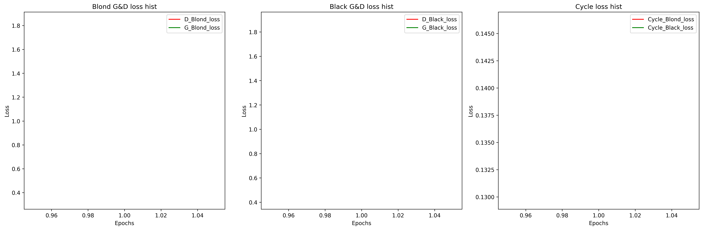

# CycleGAN 图像翻译：黑发 ⇄ 金发

基于 **CycleGAN** 的**非配对**图像翻译项目。用 CelebA 人脸数据集，把黑发人脸翻译成金发、金发人脸翻译成黑发。

与 Pix2Pix 不同，CycleGAN **不需要成对数据** —— 黑发的人和金发的人是两批不同的人，网络靠「循环一致」约束自己学会两个方向的映射。

> 项目进行中：模型与数据流水线已完成并通过验证，正在训练调参。

## 训练损失曲线



三个子图分别是 Blond 域的 G/D 损失、Black 域的 G/D 损失、以及两个方向的循环一致损失。

## 数据集

- 来源：Kaggle [CelebFaces Attributes (CelebA)](https://www.kaggle.com/datasets/jessicali9530/celeba-dataset)
- 原始规模：**202,599** 张 `img_align_celeba` 图片（178×218）
- 属性表：`list_attr_celeba.csv`（202599 × 41），标签取值 `1`（有此属性）/ `-1`（无）

按头发颜色拆成两个域：

| 域 | 属性 | 可用张数 | train | test |
|---|---|---|---|---|
| **A（Black）** | `Black_Hair == 1` | 48,469 | 38,775 | 9,694 |
| **B（Blond）** | `Blond_Hair == 1` | 29,980 | 23,984 | 5,996 |

> CelebA 的 40 个属性是独立标注的，有 **3 张**图同时满足 `Black_Hair` 和 `Blond_Hair`。这类图放哪个域都会污染配对，直接丢弃（48,472 + 29,983 − 3 = 78,449 张参与划分）。

预处理（`gan_data.py`）：

- **训练**：`Resize(286, BICUBIC)` → `RandomCrop(256)` → `RandomHorizontalFlip()`
- **测试**：`Resize(256, BICUBIC)` → `CenterCrop(256)`
- 两者都接 `ToTensor()` + `Normalize((0.5,)*3, (0.5,)*3)`，把像素映射到 `[-1, 1]`，与生成器末层的 `Tanh` 对应

数据集体积较大（约 1.9 GB），**不纳入版本管理**。

## 网络结构

### 生成器 Generator（`resnet_9blocks`，ngf=64）

输入 `3×256×256`，输出 `3×256×256`，共 **11,378,179** 参数。

| 阶段 | 结构 | 输出尺寸 |
|---|---|---|
| c7s1-64 | `ReflectionPad2d(3)` + `Conv2d(3→64, k=7, s=1, p=0)` + IN + ReLU | 64×256×256 |
| d128 | `Conv2d(64→128, k=3, s=2, p=1)` + IN + ReLU | 128×128×128 |
| d256 | `Conv2d(128→256, k=3, s=2, p=1)` + IN + ReLU | 256×64×64 |
| R256 ×9 | 残差块：`ReflectionPad2d(1)` + `Conv2d(256→256, k=3)` + IN + ReLU，再来一遍，最后 `x + block(x)` | 256×64×64 |
| u128 | `ConvTranspose2d(256→128, k=3, s=2, p=1, output_padding=1)` + IN + ReLU | 128×128×128 |
| u64 | `ConvTranspose2d(128→64, k=3, s=2, p=1, output_padding=1)` + IN + ReLU | 64×256×256 |
| c7s1-3 | `ReflectionPad2d(3)` + `Conv2d(64→3, k=7, s=1, p=0)` + `Tanh` | 3×256×256 |

### 判别器 Discriminator（PatchGAN，ndf=64，n_layers_D=3）

输入 `3×256×256`，输出 `1×30×30`，共 **2,764,737** 参数。

| 层 | 结构 | 输出尺寸 |
|---|---|---|
| 1 | `Conv2d(3→64, k=4, s=2, p=1)` + `LeakyReLU(0.2)` | 64×128×128 |
| 2 | `Conv2d(64→128, k=4, s=2, p=1)` + IN + `LeakyReLU(0.2)` | 128×64×64 |
| 3 | `Conv2d(128→256, k=4, s=2, p=1)` + IN + `LeakyReLU(0.2)` | 256×32×32 |
| 4 | `Conv2d(256→512, k=4, s=1, p=1)` + IN + `LeakyReLU(0.2)` | 512×31×31 |
| 5 | `Conv2d(512→1, k=4, s=1, p=1)` | 1×30×30 |

> 输出不是单个 0/1，而是一张 **30×30 的真假特征图**，每个点对应原图上一块 70×70 的感受野。算损失时对这 900 个数一起做 MSE。
>
> 第一层后面不接 norm。全网络**没有全连接层**。

### 归一化的选择

生成器与判别器**都用 `InstanceNorm2d(affine=False, track_running_stats=False)`**，不用 BatchNorm：

- `batch_size=1` 时 BatchNorm 的训练/推理行为不一致（推理用滑动统计量），实测同一张图输出差异可达 0.16
- InstanceNorm 逐图逐通道统计，与 batch 大小无关，训练/推理完全一致
- 图像翻译里「风格」是逐图的，本来就不该跨图统计

## 训练配置

| 配置项 | 取值 |
|---|---|
| Batch Size | 1（官方默认；配 InstanceNorm） |
| 优化器 | `Adam(lr=0.0002, betas=(0.5, 0.999))` |
| 优化器数量 | **2 个**：`opt_G` 管两个生成器，`opt_D` 管两个判别器 |
| 对抗损失 | LSGAN（`MSELoss`），真图目标 1、假图目标 0 |
| 循环一致损失 | `L1Loss`，权重 **10.0** |
| 权重初始化 | `normal(0, 0.02)` |
| 设备 | CUDA（自动回退 CPU） |
| 更新顺序 | **先 G 后 D**（CycleGAN 与 Pix2Pix 相反） |

一次迭代的数据流：

```
real_Black ──G_Blond──> fake_Blond ──G_Black──> rec_Black   (正向循环)
real_Blond ──G_Black──> fake_Black ──G_Blond──> rec_Blond   (反向循环)
```

四个损失项：

1. `loss_GAN`：`D_Blond(fake_Blond)` 与 `D_Black(fake_Black)` 都要被判为真
2. `loss_cycle`：`L1(rec_Black, real_Black) + L1(rec_Blond, real_Blond)`，权重 ×10
3. `loss_D_Blond`：真金发判 1、假金发判 0
4. `loss_D_Black`：真黑发判 1、假黑发判 0

> 更新 G 时判别器的输出不参与反传（更新 D 前会 `zero_grad`）；更新 D 时对 `fake_*.detach()`，避免梯度回传到生成器。

## 项目结构

```
GAN/CycleGAN/
├── data_pre.ipynb      # 数据预处理：把 CelebA 拆成 trainA/trainB/testA/testB
├── gan_data.py         # 数据准备与加载模块（可 import 调用）
├── model.py            # 模型定义：生成器 / 判别器 / 残差块 / 权重初始化
├── MAIN.ipynb          # 训练脚本
├── README.md           # 项目说明
└── sample/
    └── loss_history.png    # 训练损失曲线
```

数据集不在此目录内，需自行下载后放到 `data/`（见下）。

## 使用方法

### 环境依赖

```
torch
torchvision
pandas
numpy
matplotlib
pillow
```

### 准备数据

1. 从 Kaggle 下载 `img_align_celeba.zip` 和 `list_attr_celeba.csv`，放到 `data/` 下，解压后目录结构为：

```
data/
├── list_attr_celeba.csv
└── img_align_celeba/
    └── img_align_celeba/      # 202,599 张 jpg
```

2. 运行 `data_pre.ipynb`，或直接调用模块：

```python
from gan_data import prepare_celeba

stats = prepare_celeba()          # 拷贝（不动原图），返回各集合数量
print(stats)
# {'total_a': 48469, 'total_b': 29980, 'dropped_double_label': 3,
#  'trainA': 38775, 'testA': 9694, 'trainB': 23984, 'testB': 5996, 'total': 78449}
```

想先快速跑通，可以限制每个域的张数：

```python
stats = prepare_celeba(max_per_domain=2000)
```

### 加载数据

```python
from gan_data import get_dataloaders, unpaired, denorm

dl = get_dataloaders(size=256, batch_size=1, num_workers=0)

for real_Black, real_Blond in unpaired(dl.train_Black, dl.train_Blond):
    ...    # 一轮 = len(dl.train_Black) 对
```

`get_dataloaders()` 返回 `CycleGANData(train_Black, train_Blond, test_Black, test_Blond)`，字段名对应域，磁盘目录仍是 `trainA/trainB/testA/testB`（A = Black，B = Blond）。

`unpaired(a, b)` 内部用 `itertools.cycle` 处理两个域数量不等的情况 —— 裸 `zip` 会截断到短的那一边，全量数据下每轮会白扔 18,489 张黑发图。

### 训练

打开 `MAIN.ipynb` 依次运行即可。注意把数据路径改成你自己的：

```python
dl = get_dataloaders(size=256, batch_size=1, num_workers=0)
```

> **时间提示**：全量数据下 `batch_size=1`、256×256 约 0.15 秒/步，一轮 38,775 步 ≈ 1.6 小时。想快速验证可以先 `Subset(2000)`，约 6 分钟/轮。

## 说明与局限

- 项目**进行中**，模型结构与数据流水线已通过验证，超参仍在调整。
- 训练分辨率为 **256×256**，全量训练在单张 8 GB 显卡上耗时较长，当前用子集快速迭代。
- 判别器输出的是 PatchGAN 特征图（30×30），不是单个真伪概率。
- 数据集来源于 Kaggle，仅用于学习研究，版权归原作者所有。
- 单模型权重约 43 MB（生成器），四个网络合计约 108 MB；若后续提交权重，注意仓库体积。
